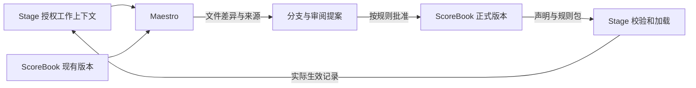

# ScoreBook 架构设计

> 本文解释 ScoreBook 在 OrchestraCorp 四模块架构中的职责。当前目录是通用模板，本文是设计稿，尚无自动校验、发布或同步程序。

## 一、定位

ScoreBook 根目录是产品模板和参考资料；企业实际使用的 ScoreBook 从 `reference-company/` 实例化。实例保存组织的可版本化规范，以及经过确认、可复用的组织记忆，并为人、Maestro、Stage 和 Virtuoso 提供可以引用准确版本的依据。

内容交付采用“完整默认组织操作手册＋企业调整＋正式组织知识”。通用架构不要求手册保持空白：软件内核可配置，参考手册可以提供明确的默认管理选择，企业采纳和发布后再生效。

以乐谱作比喻：ScoreBook 描述采用什么规则和方法，Stage 记录当前实际发生的工作，Maestro 整理和协调二者，Virtuoso 承载员工及其 Agent 的工作。

权威范围按对象划分，避免把 Git 与 Stage 都设成同一事实的可写来源。

## 二、哪些内容以 ScoreBook 为准

| 内容 | ScoreBook 保存 | Stage 保存 |
|---|---|---|
| 组织规则 | 宪章、授权原则、信息分类、评价制度及批准版本 | 实际加载版本、适用范围、运行核验结果 |
| 岗位 | 使命、职责、能力要求、授权边界、协作与接管规则 | 任职人、当前组织关系、容量、工作承诺 |
| Agent | 能力定义、配置模板、工具上限、适用数据域和版本 | 实例身份、实时授权、凭据状态、运行、停用和撤销 |
| 知识 | 经确认的 SOP、Skill、案例、模板和来源引用 | 原始任务过程、消息、工具事件、待整理上下文 |
| 决策 | 正式决定的依据、批准内容、版本、取代关系和目标生效条件 | 实际激活、执行、暂停、撤销及当前有效版本 |
| 归档 | 允许归档的历史快照、证据清单和版本引用 | 当前任务、运行事件及实时查询 |

规则定义在 ScoreBook 中审阅，不代表任何文件都可以直接执行。机器可执行规则需要明确 schema、验证和发布边界；自然语言资料供理解与审阅使用。

Stage 中的即时撤销不能被一次旧 Git 配置重新覆盖。ScoreBook 可以归档 Stage 的历史生效回执，但不手工维护第二套“当前已生效”状态。

## 三、当前目录树与功能设计

### 3.1 盘点范围和阅读方式

以下目录树以 **2026-10-19 本地文件盘点**为准：共 128 个文件，其中 125 个 Markdown、3 个 YAML；产品根目录 4 个文件，`docs/` 1 个文件，`examples/` 7 个文件，`reference-company/` 116 个文件。它说明已经存在的文档与模板，不表示已经实现对应的软件功能。

目录树列出全部一级功能域及其文件。为避免重复，10 个部门只列目录名，随后用统一的部门子树展开；每个部门都有相同的 7 个文件，共 70 个文件。树中的中文注释是功能解释，不是额外文件名；`<department>/` 只表示这些现有部门中的任意一个。

### 3.2 产品模板和参考公司

```text
ScoreBook/
├── AGENT.md                           产品模板维护指令
├── AGENTS.md                          指向 AGENT.md 的兼容入口
├── README.md                          产品入口和采用方式
├── architecture.md                    本文：目录、功能和权威边界
├── docs/
│   └── repository-lifecycle-design.md  GitLab 初始化、权限、协作和升级设计提案
├── examples/                          外部参考，当前只有分类说明和来源模板
│   ├── README.md                      资料引入与使用规则
│   ├── open-source/README.md          开源知识参考入口
│   ├── organization-patterns/README.md 组织模式参考入口
│   ├── department-templates/README.md 部门和岗位模板参考入口
│   ├── agent-patterns/README.md        Agent 模式参考入口
│   ├── licenses/README.md              来源许可与改编限制入口
│   └── sources/source.template.yaml   来源元数据模板
└── reference-company/                 可整体复制的参考公司内容
    ├── AGENT.md                       企业实例的 Maestro 入口
    ├── AGENTS.md                      指向本层 AGENT.md 的兼容入口
    ├── README.md                      企业采用和内部导航
    ├── operating-handbook/            组织运行方法：11 章参考初稿
    │   ├── README.md
    │   ├── writing-plan.md            手册编写纲要与原始写作依据
    │   ├── charter.md                 宪章与组织原则
    │   ├── goals-and-resources.md      目标、优先级与资源配置
    │   ├── roles-and-teams.md         岗位、团队与责任
    │   ├── work-and-collaboration.md  分派、认领、承诺、协作与验收
    │   ├── decisions-and-authority.md 决策、授权与监督
    │   ├── customers-and-delivery.md  客户、业务与交付
    │   ├── money-contracts-and-assets.md 资金、合同与资产
    │   ├── people-growth-and-rewards.md 人才、成长与激励
    │   ├── agents-and-digital-work.md Agent 与数字工作
    │   ├── information-and-knowledge.md 信息、知识与组织记忆
    │   └── quality-risk-and-continuity.md 质量、风险与持续运行
    ├── governance/                    治理配置与分类原则
    │   ├── constitution.template.md   企业宪章填写模板
    │   ├── authority.template.yaml    授权主体、动作与范围模板
    │   └── information-classification.md 信息分类模板
    ├── organization/                  稳定组织模型和岗位契约
    │   ├── organization-model.md
    │   ├── decision-rights.md
    │   ├── role-contract.template.md
    │   ├── role-contracts.md           岗位契约索引
    │   └── role-contracts/
    │       ├── cross-functional-task-owner.md 跨岗位任务负责人
    │       ├── knowledge-steward.md   知识维护责任人
    │       └── internal-service-owner.md 内部服务负责人
    ├── agents/
    │   └── registry.template.yaml     Agent 注册结构起点，列表为空
    ├── knowledge/                     可复用资料的格式和虚构示例
    │   ├── README.md
    │   ├── templates/
    │   │   ├── task-context.template.md
    │   │   ├── collaboration-request.template.md
    │   │   ├── acceptance-evidence.template.md
    │   │   ├── handover-checklist.template.md
    │   │   ├── knowledge-entry.template.md
    │   │   └── decision-record.template.md
    │   └── samples/
    │       ├── cross-functional-delivery-context.sample.md
    │       ├── cross-functional-collaboration-request.sample.md
    │       ├── knowledge-capture-support-triage.sample.md
    │       └── role-handover-internal-service.sample.md
    ├── decisions/README.md             正式决策记录与版本状态约定
    ├── repositories/catalog.md         代码仓、知识仓、系统和连接器索引模板
    ├── archives/README.md              历史快照、证据和回执归档约定
    ├── departments/                   10 个部门，各含下节所列 7 个文件
    │   ├── executive-and-strategy/     经营与战略
    │   ├── product/                    产品
    │   ├── engineering/                工程
    │   ├── sales-and-marketing/        销售与市场
    │   ├── customer-success/           客户成功
    │   ├── operations/                 运营
    │   ├── people-and-culture/         人才与文化
    │   ├── finance/                    财务
    │   ├── legal-and-compliance/      法务与合规
    │   └── information-technology-and-security/ IT 与安全
    └── cross-functional/              多个部门共同采用的方法
        ├── README.md
        ├── planning.md                计划、优先级与承诺影响
        ├── operating-rhythm.md        组织复核节奏
        ├── internal-services.md       内部服务接口与升级路径
        └── shared-knowledge.md        跨部门知识整理与发布原则
```

每个现有部门的内部结构均为：

```text
departments/<department>/
├── README.md                部门入口与参考使命
├── charter.md               使命、专业边界和不负责的事项
├── responsibilities.md      持续责任、自主判断和升级条件
├── interfaces.md            协作方、输入、输出与升级条件
├── role-catalog.md          参考岗位、主要结果、能力和备份方式
└── knowledge/
    ├── README.md            部门知识入口和默认检查要点
    └── operating-checklist.md 部门操作检查表
```

### 3.3 各功能域的职责与当前完成度

| 功能域 | 要解决的问题与产物 | 当前已有内容与边界 |
|---|---|---|
| 根目录入口 | 让模板维护者理解产品定位、维护规则和实例化方法 | 4 个说明文件；根 `AGENT.md` 管模板维护，企业入口在下一层 |
| `docs/` | 描述从参考内容到企业 Git 多仓使用与持续演进的产品能力 | 1 份 GitLab 优先的初始化、授权与演进设计提案；尚未实现其中工具 |
| `examples/` | 保存外部实践的参考入口、来源和许可依据 | 分类说明及来源模板已存在；尚未引入具体外部项目材料，也没有自动采集器 |
| `operating-handbook/` | 说明一家参考组织应怎样运行，提供可审阅的默认管理选择 | 11 章参考初稿、入口和写作纲要已存在；仍需一致性审阅、场景验证及企业采用 |
| `governance/` | 描述企业使命、治理原则、授权结构和信息分类 | 宪章与信息分类模板、空授权规则列表；没有策略计算或权限执行程序 |
| `organization/` | 将组织运行要求落到岗位责任、决策范围和接管要求 | 组织模型、决策权、岗位字段模板及 3 份岗位契约；实际任职与授权由 Stage 管理 |
| `agents/` | 提供 Agent 定义和登记的组织内容入口 | 只有空注册表模板；能力定义、工具约束和配置 schema 尚待补充，不代表已注册运行 Agent |
| `knowledge/templates/` | 统一工作上下文、协作、验收、交接、知识和决策的记录格式 | 6 份自然语言模板；是填报与审阅约定，尚无机器校验或自动生成 |
| `knowledge/samples/` | 示范如何填写模板和保留未知项 | 4 份明确标记的虚构样例；不代表真实任务、承诺、授权或组织经验 |
| `decisions/` | 保存影响规则、资源和长期记忆的正式决定 | 当前只有记录原则和状态约定；决策字段模板在 `knowledge/templates/`，本目录尚无决定实例 |
| `repositories/` | 告诉使用者代码、业务系统和连接器在哪里、谁负责 | 空目录表；只做受权限约束的索引，不复制各业务仓或系统数据 |
| `archives/` | 定义历史快照、证据清单、版本和回执的归档要求 | 当前只有约定；没有快照文件、导出程序或灾备实现 |
| `departments/` | 列出长期专业能力、持续责任和部门协作接口 | 10 个部门共 70 份参考文档；是可调整的职责基线，不是现实部门编制或人员名册 |
| `cross-functional/` | 给跨部门工作提供共同的计划、节奏、服务和知识原则 | 5 份说明文件；实时协作事项、承诺与阻塞状态由 Stage 管理 |

这里的“功能”主要是**内容与职责设计**。当前目录没有应用代码、schema 校验器、CI 检查、实例化脚本、发布器或 Stage 连接程序；Markdown 和 YAML 文件本身不会创建组织、授予权限或执行任务。

### 3.4 十个部门的功能与主要协作接口

下表提炼自各部门现有 `charter.md` 与 `interfaces.md`，只概括主要接口；完整输入、输出与升级条件仍以对应文件为准。这些是参考职责，不表示企业必须设立十个独立部门。

| 部门 | 参考使命 | 主要接口：输入 → 输出 |
|---|---|---|
| 经营与战略 | 让经营方向、目标、资源、取舍与风险承受能力一致 | 财务的现金与预算证据 → 资源优先级；业务部门的能力、客户证据和约束 → 目标顺序、停止条件与例外决策 |
| 产品 | 明确服务谁、解决什么问题，以及如何验证价值 | 销售/客户成功的问题反馈 → 需求判断与范围回应；工程的可行性和成本质量约束 → 方案、优先级与验收 |
| 工程 | 将产品和业务需求实现为可靠、可维护、可验证的技术能力 | 产品的问题范围和验收要求 → 技术方案与交付风险；运营/客户成功的问题复现 → 修复与规避方案；IT/安全的基线 → 修复与运行证据 |
| 销售与市场 | 连接市场需求与价值，形成可信表达和可履行承诺 | 产品/工程的能力边界 → 市场需求与售前问题；财务的定价回款约束 → 商业方案；客户成功/运营的履约能力 → 成交交接与预测 |
| 客户成功 | 帮助客户持续获得约定价值，连接沟通与公司改进 | 销售的合同目标和承诺 → 接入确认与续约风险；运营的履约异常 → 客户要求和验收协调；产品/工程的能力状态 → 问题复现与价值反馈 |
| 运营 | 将公司承诺转化为稳定、可重复、可度量的日常交付 | 销售/客户成功的范围与承诺 → 履约计划和异常；产品/工程的变更支持 → 作业反馈和自动化需求；财务规则 → 采购验收与结算依据 |
| 人才与文化 | 获得、发展和公平对待履行岗位责任所需的人才 | 责任岗位的能力缺口与负荷证据 → 招聘培养方案；财务的人力预算 → 核算输入；与 IT/安全协作办理入转离职的账号、设备和权限变更 |
| 财务 | 提供可信财务事实与现金资源约束，维护资金安全 | 经营的目标投资方案 → 现金成本情景与预算建议；业务的订单履约和退款请求 → 应收核验；运营的申请验收资料 → 付款核验与回执 |
| 法务与合规 | 将适用义务和法律风险转成可执行的业务边界 | 交易背景与偏离需求 → 审查意见；人才与文化的用工事实 → 程序证据建议；产品/工程/IT安全的数据用途与依赖 → 义务、许可和数据边界 |
| IT 与安全 | 提供可靠数字工作环境，保护身份、设备、信息和访问边界 | 岗位及人员变更 → 账号、设备和权限回执；工程接入需求 → 身份、安全与隔离；数据责任岗位的目的与分类 → 受控访问；连续性目标 → 恢复与演练结果 |

### 3.5 内容之间怎样连接

推荐的引用关系是：手册说明共同原则，治理资料填写企业参数，组织与部门资料说明责任和接口，岗位契约说明具体岗位的边界；实际工作通过 Stage 的任务和授权记录推进。工作产生的证据经整理后，可形成知识条目或正式决定，再进入相应目录并保留来源版本。

- **手册与治理**：手册写默认运行方法，治理资料承载企业采用时的使命、分类和授权配置。按手册入口的现有约定，`operating-handbook/charter.md` 是统一宪章正文，`governance/constitution.template.md` 保留为起步填写模板；后续应补齐引用与差异记录，避免企业维护两份平行宪章。
- **岗位与部门**：`organization/role-contracts/` 保存岗位契约，`departments/*/role-catalog.md` 说明专业领域需要哪些岗位；引用统一岗位标识，避免各自定义同名但不同责的岗位。当前仍需补齐统一标识和更多岗位契约。
- **部门与跨部门方法**：部门 `interfaces.md` 写明提供什么、需要什么；`cross-functional/` 规定共同如何计划、受理、升级和复盘。两者维护稳定约定，当前事项引用 Stage。
- **模板与记录**：模板放在 `knowledge/templates/`，虚构示例放在 `knowledge/samples/`；正式企业决定放在实例的 `decisions/`，正式知识按领域归入知识目录。模板不等于已经填写或批准的记录。
- **定义与运行**：ScoreBook 中的岗位、授权和 Agent 文件描述目标定义；Stage 保留实际任职、授权判断、加载版本和运行结果。历史回执可以归档，但不改写为另一份当前状态。

这些关系是本版功能设计要求，当前并没有程序强制检查引用、标识唯一性或配置一致性。

### 3.6 企业采用边界

`reference-company/` 是第一套可以被 Maestro 和企业实例使用的组织乐谱。根目录的模板、示例和架构说明不作为企业运行入口。

企业复制该子目录中的完整内容，建立自己的独立 Repo；其中的 `AGENT.md` 随之成为企业 Repo 根入口。公司目录内部不依赖父级指令，也不要求复制外层 `examples/` 或其他产品模块。当前内容具备参考手册初稿与部门骨架，尚未经企业采用，也未绑定运行中的 Stage。

采用时需要填写真实使命和责任安排、选择适用制度、配置数据与权限边界、审阅并发布企业版本，再通过后续建设的 Stage 导入与回执协议确认实际生效。复制目录完成内容初始化；实际组织配置、权限开通与运行接入仍需各自完成。

下一阶段采用[仓库生命周期设计提案](docs/repository-lifecycle-design.md)：以自托管 GitLab 为首版，按实际读者集合生成独立仓库，保留模板生成基线，提供计划、执行、实际权限核验和升级差异。该生成路径尚未实现；本节整体复制仍是当前内容采用方式，不代表可将不同读者的真实资料放入同一仓库。

## 四、通用模板与企业实例

### 4.1 产品模板

当前 `OrchestraCorp/ScoreBook` 根目录提供通用结构、规范、字段模板和参考机制；`reference-company/` 提供第一套完整的默认组织骨架，不放真实人员、客户、薪酬、合同和业务资料。

模板升级维护产品能力；不自动覆盖企业已经审阅确认的个性化制度。

### 4.2 企业实例

企业采用模板后，在自己的受控仓库中填写宪章、岗位契约、政策、Agent 定义和正式知识，并绑定自己的 Stage。

不同公司的实际内容与产品模板隔离，也不混在一个全局可检索的公司资料库中。企业可以锁定模板版本，审阅差异后再升级。

### 4.3 一个 ScoreBook 可以对应多个仓库

ScoreBook 是逻辑上的治理与知识资产域。物理上可以按读者范围拆成公共资料、内部治理、部门知识和受限档案等仓库，并由授权索引连接。

目录名、分类标签和 CODEOWNERS 不能单独承担敏感信息的读取隔离。需要限定读者的材料使用真实的仓库权限或受限存储；凭据不进入任何 Git 文件。索引、摘要、缓存与检索继续遵守来源权限，不能借汇总公开敏感事实。

## 五、以内容对象管理文档

拟为正式内容逐步统一以下信息；具体字段和 schema 待下一步确定：

- 稳定内容标识、类型、标题和所属知识域。
- 责任岗位、数据分类、允许的使用范围。
- 来源任务、决定、交付物或其他依据。
- 草案、提案、批准或发布等内容状态。
- 版本、取代关系、复核时间与适用条件。
- 对应 Stage 发布或验收记录的引用。

事实、建议、推断和批准内容分开标记。讨论中出现过的想法不自动升级为正式规则；业务经验也不能只因被总结就变成可执行 Skill。

大文件、原始录音、数据库备份和高频日志优先放在适合的存储中，ScoreBook 保存受权限约束的引用和完整性信息。Git 归档不能替代 Stage 数据库、附件及运行环境的灾备。

## 六、Maestro 怎样维护 ScoreBook



Maestro 需要有足够的领域工作能力：读取允许的上下文和历史文件，判断新增或更新，维护关联，直接编辑真实文件并通过受控 Git 工具提交。

它应保留来源、未决问题和检查结果；提交后核对实际文件与准确版本。对重要结论的业务审阅、治理合并和运行生效分别处理。

固定字段快照可由程序导出；需要理解、去重、归纳和改写的资料由 Maestro 处理。无需把所有归档都交给模型，也不把所有整理工作交给机械同步程序。

知识域较多时，可以按域配置多个 Maestro 身份或任务，而非让一个首脑 Agent 永久持有全公司原始资料与发布权。

## 七、发布与生效的职责

1. ScoreBook 保存拟发布或已批准的内容，以及准确 Git 版本。
2. Stage 验证来源、配置、授权和兼容性，决定是否能够加载。
3. 实际加载成功、失败、回滚及当前有效版本，权威记录在 Stage。
4. 历史生效回执可以按权限归档，必须注明时间、来源和版本。

不把 Markdown 的 `status: enacted` 手工修改当作系统已生效的证据，也不让 Maestro 同时起草、批准并扩大自身运行权限。

## 八、当前状态与后续建设

### 8.1 已存在的内容

截至 2026-10-19，已创建产品入口与架构文档、外部参考分类入口、11 章默认组织手册参考初稿、治理模板、组织模型、3 份岗位契约、10 个部门骨架、跨部门方法、6 份记录模板及 4 份虚构样例。

另已保存 GitLab 优先的仓库初始化、授权、Git 协作、模板升级与知识演进设计提案；生成器、配置 schema 和 GitLab adapter 均未实现。

根入口、公司 `AGENT.md` 和手册编写纲要已同步为“参考初稿已建立”的当前状态；这不代表内容已经通过完整验收或被企业采用。

授权矩阵、Agent 注册表和系统目录均为空模板；决策目录与归档目录只有说明。它们不包含任何真实企业、人员、客户、权限或运行事实。本地当前目录没有 `.git/`，本次盘点不能提供 Git 提交号或已发布版本证据。

### 8.2 未决问题

| 问题 | 当前证据 | 下一步需要确认的结果 |
|---|---|---|
| 宪章引用与填写方式 | 已约定 `operating-handbook/charter.md` 为统一正文；`governance/constitution.template.md` 保留起步模板 | 补齐两者引用、企业参数填写及差异记录方式，避免平行维护 |
| 信息分类词汇 | 治理分类模板使用 `locked`，知识模板使用 `highly-restricted` | 统一分类字典、迁移方式和下游解释；目录标签仍不代替权限 |
| 手册验收 | 11 章已有实质参考初稿，尚无完整一致性审阅或企业场景验收记录 | 定义内容验收标准，补齐企业必填、可调整项和适用性验证 |
| 正式内容元数据 | 文档的责任岗位、分类、来源和复核字段尚未全面统一 | 确定各内容类型必填字段、稳定标识、状态含义和 schema |
| 运行接入 | 没有发布器、Stage 导入或生效回执实现 | 明确发布包、版本锁定、验证、加载失败、回滚与回执协议 |

上述问题保留为待决事项，不在本次目录说明中推定已经解决。

### 8.3 后续建设

后续优先补齐：

- 正式文档与机器配置的 schema 和校验。
- 默认组织手册的一致性审阅、场景验证、企业必填内容和可调整边界。
- 更多岗位契约、政策、知识和 Skill 参考内容，以及 Agent 定义格式。
- 企业实例化与模板升级的边界。
- 受限仓库的索引和权限配置。
- 可核验的发布清单，以及与 Stage 的导入、加载和回执协议。
- Maestro 整理提案、来源核对和产物检查能力。

这些工作不预设具体公司编制、行业流程或全部企业都采用同一管理制度。

### 8.4 本文来源与维护

- **来源**：2026-10-19 对本目录的实际文件清单与内容查阅，尤其是根 `AGENT.md`、各功能域入口、手册 11 章的文件及状态、治理 YAML 与知识模板。本文没有将外部参考网页作为已核验的当前产品能力证据。
- **责任岗位**：建议由 ScoreBook 模板维护责任岗位维护；实际责任人和审阅人尚未指定。
- **分类与效力**：`internal`、`architecture-draft`、版本 `0.5`、`policy_effect: none`；这是设计与盘点文档，不代表企业制度已批准或已生效。
- **复核条件**：增删目录、调整内容归属、统一宪章或分类、增加 schema/脚本、修改模块权威边界、形成发布或 Stage 接入实现时复核；下一次对外发布或企业采用前重新盘点。

## 参考

- [GitLab 保护仓库](https://docs.gitlab.com/user/project/repository/protect/)：推送、合并、审阅与仓库保护机制，具体能力按部署版本核实。
- [ScoreBook 模板说明](README.md)
- [Reference Company 入口](reference-company/README.md)
- [Maestro 职责](../Maestro/README.md)
- [Stage 职责](../Stage/README.md)
- [Virtuoso 职责](../Virtuoso/README.md)
